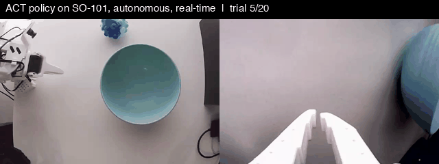

# SO-101 ACT Pick-and-Place

Teleoperated data collection, policy training and real-robot evaluation on a low-cost **SO-101** arm with [LeRobot](https://github.com/huggingface/lerobot). An ACT policy trained from 49 demonstrations picks up a ball and places it in a bowl, reaching **14/20 (70%)** success on the real robot.



*Autonomous ACT rollout, real-time. Left: fixed top camera. Right: wrist camera.* A longer clip with four successes and one failure: [`media/act_trials.mp4`](media/act_trials.mp4).

## Setup

| | |
|---|---|
| Robot | SO-101 follower arm (6 DoF incl. gripper) + SO-101 leader arm for teleoperation |
| Cameras | 2 × USB, 640×480 @ 30 fps: fixed top view and wrist view |
| Task | "Pick up the ball and put it in the bowl". The bowl is fixed; the ball is placed on either side of it |
| Recording and inference | MacBook Air M1, 8 GB (PyTorch MPS) |
| Training | Remote server, NVIDIA RTX A6000 |
| Software | LeRobot 0.7.1 |

## Data

- **49 teleoperated demonstrations**, 24,281 frames (~13.5 min) at 30 fps: [`yiming19/pick_ball_v2_clean`](https://huggingface.co/datasets/yiming19/pick_ball_v2_clean).
- A first dataset gave a policy that reached for roughly the same spot regardless of where the ball was. Inspecting frames showed inconsistent data: the bowl had moved between sessions, the lighting changed partway through, and several episodes started with the ball already in the bowl. The dataset was re-recorded with a fixed bowl, a single lighting condition and a consistent start pose, and one bad episode was removed.

## Policy

ACT trained from scratch (ResNet-18 backbone with ImageNet weights). Inputs: joint state (6) and both camera images.

| Setting | Value |
|---|---|
| Action chunk | 100 steps (3.3 s), executed fully before re-planning |
| Training | 100k steps, batch size 8, AdamW, lr 1e-5 |
| Inference on M1 | ~130 ms per chunk |

Model: [`yiming19/act_pick_ball_v2`](https://huggingface.co/yiming19/act_pick_ball_v2).

## Results

20 trials, ball position varied across both sides of the bowl, 20 s limit per trial. Each trial starts with the arm slightly raised (see *Known issues*).

| Ball position (robot's view) | Success |
|---|---|
| Right of the bowl | 10 / 12 |
| Left of the bowl | 4 / 8 |
| **Total** | **14 / 20 (70%)** |

**Failure analysis.** All 6 failures happened at the grasp: the arm reached the correct location, but the gripper closed slightly off and the ball slipped or was pushed away; the arm then moved to the bowl empty-handed. Two of the failures had the ball closer to the base than anywhere in the training data. The left side requires a more lateral approach, where small errors grow during the 3.3 s open-loop chunk.

**Shorter chunks.** Executing 50 of the 100 predicted steps before re-planning (left side only) gave 3/5 with visibly steadier grasps, at the cost of a short pause every 1.7 s. The sample is too small to draw a conclusion.

**SmolVLA.** A SmolVLA policy fine-tuned from `lerobot/smolvla_base` on the same data (20k steps, batch 64) reproduces the demonstrated actions closely offline (mean error 0.7° one second ahead), but reached only 1/8 on the robot: inference takes ~1.1 s per chunk on the M1, so the arm stops for over a second every 1.7 s. It needs GPU inference or asynchronous execution (e.g. real-time chunking) to be evaluated fairly.

## Known issues

- **Idle start.** The demonstrations begin with 2–5 s of the operator holding still, so from the exact start pose the policy predicts "wait" and may not move. Raising the arm 2–3 cm before each trial avoids this; trimming the idle frames from the data is the proper fix.

## Next steps

- Real-robot latency experiments: inject 0 / 200 / 400 ms of observation delay and measure how success degrades, following my simulation study of delayed sensor inputs in VLA policies (SyncVLA, under review).
- Re-train ACT and SmolVLA on data with the idle start trimmed, and run SmolVLA with GPU inference.

## Repository

| File | Purpose |
|---|---|
| `config.sh` | Hardware settings (serial ports, arm IDs, camera indices); edit only this file |
| `teleop.sh` | Teleoperation with live camera view |
| `record.sh` | Record demonstrations: `./record.sh <name> "<task>" <num_episodes>` |
| `eval.sh` | Real-robot evaluation: `./eval.sh <model> try` (60 s test) or `./eval.sh <model> <N> [action_steps]` |
| `check_policy.py` | Offline check: compares predicted and recorded actions on dataset frames |
| `make_media.py` | Builds the GIF and MP4 above from a recorded evaluation |

Trained models go in `models/<name>/` (not tracked; download from Hugging Face). Script comments are in Chinese.

```bash
conda activate lerobot          # LeRobot 0.7.1
hf auth login
./teleop.sh                     # check hardware
./record.sh pick_ball "Pick up the ball and put it in the bowl" 50
./eval.sh act_pick_ball_v2 20
```

## Author

Yiming Zhou, PhD candidate, Université Laval. [Homepage](https://yzhou19.github.io/)
